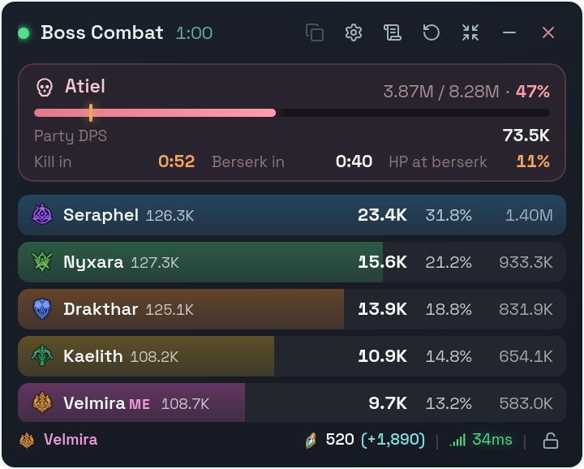
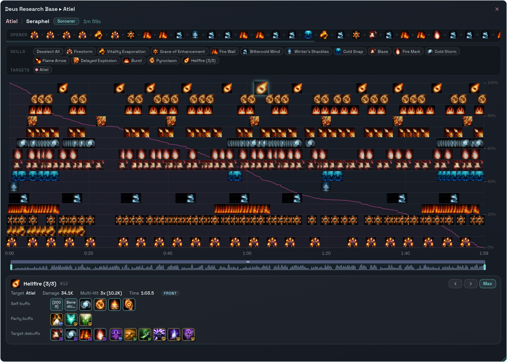
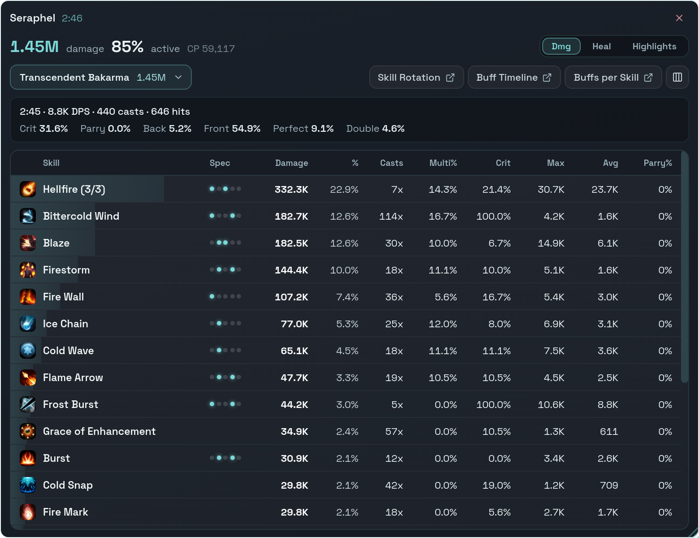
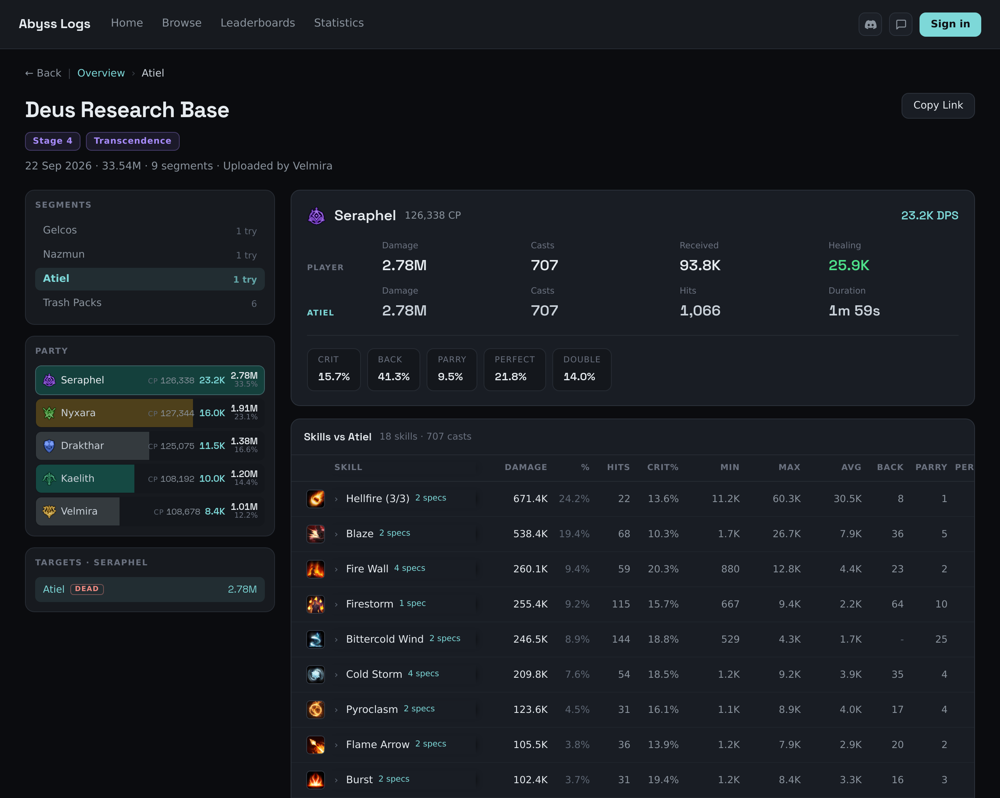
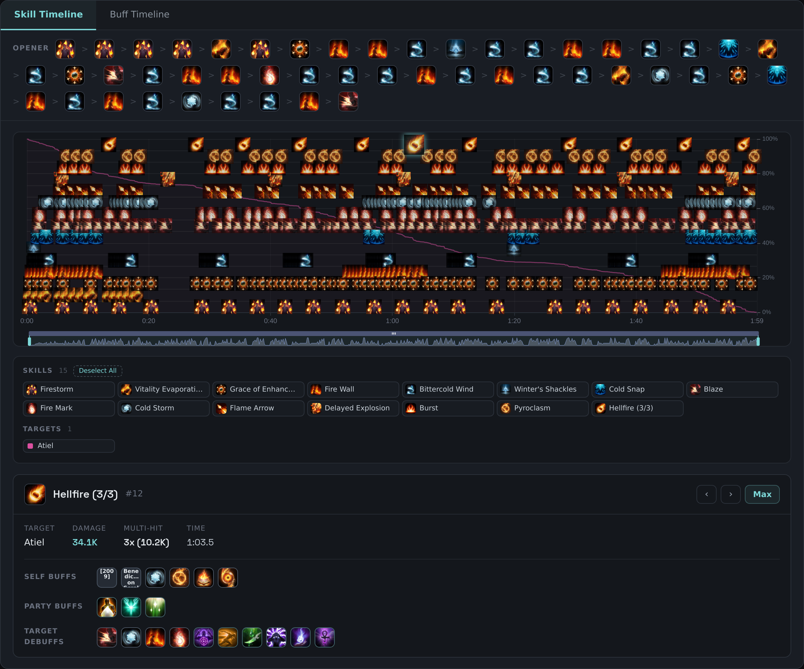
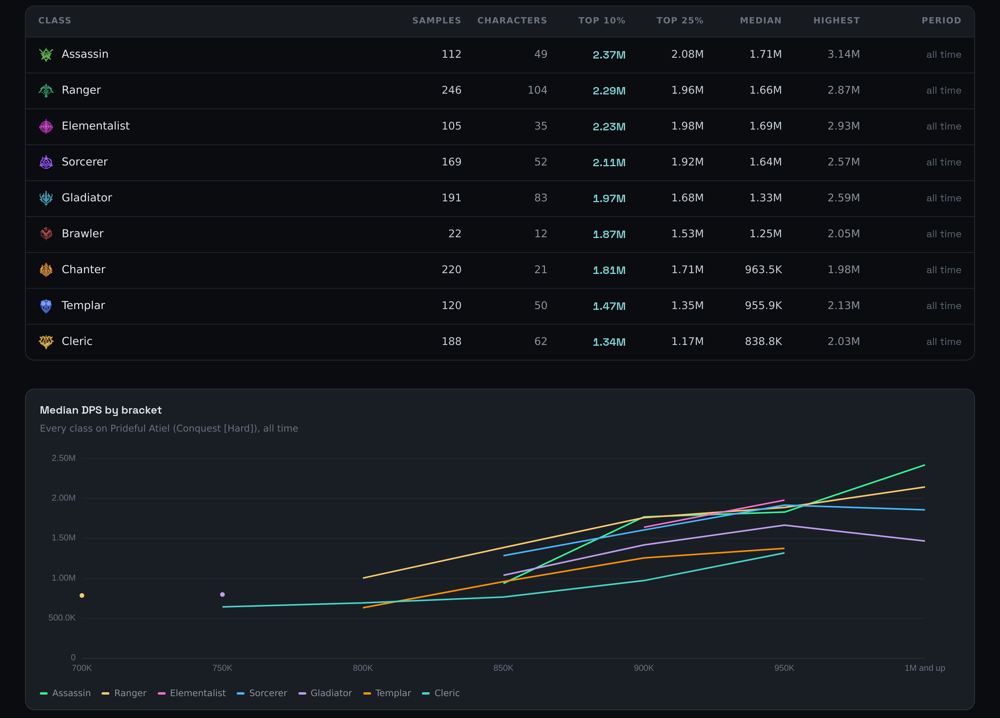

# Abyss Logs DPS Meter

**The Aion 2 DPS meter with shareable combat logs.**

Live overlay in game · one-click logs on abysslogs.com · all six regions · free

## What it does

**In game**

- **Live DPS bars** with class, combat power or gear score, and share of damage
- **Boss HP and party DPS** on the boss card
- **Berserk timer**: kill time against the boss's berserk, and its HP when berserk hits
- **eDPS or aDPS**: the whole fight, or active time only
- **Player breakdown**: targets, skills, crit, back, front, parry, perfect, double and multi-hit rates
- **Active %**: how much of the fight each player spent attacking
- **Skill Spy**: the specialities behind every skill
- **Heals** tracked on their own
- **Damage taken and deaths**: a record of all damage taken and a death recap.
- **Fight highlights**: some aggregated statistics at the end of a fight
- **Skill and buff timelines** against the boss's HP, with a player's opener sequence
- **Buffs per skill**: which buffs were up on each skill's casts, and what else was up with them
- **Boss reset detection**: a wipe ends the fight, long mechanics do not idle
- **Training dummy parse capping** at 1, 2, 3 or 5 minutes, or any length from 10 seconds to 5 minutes
- **Dungeon lobby** with everyone's gear score, combat power and ready state
- **Rank badges and nameplates**: each class's top players at their CP and its top 5 overall marked in your lobby and on the bars
- **Supporter nameplates**: supporters pick a nameplate for each verified character, and every meter shows it
- **Buff tracking**: your cooldowns, buffs and debuffs on bars over the game, with presets per class
- **Event alerts**: a popup and a sound before the Shugo Festival, Spacetime Rift and Invasion open, and when they do
- **World boss alerts**: same as event alerts
- **Field boss timers**: same as event alerts
- **Fight history** on your PC, dungeon runs grouped, searchable by player and dungeon
- **Party only** and **boss only** capture
- **Hotkeys** to hide the overlay and reset the fight
- **Fight summary** copied as text for party chat, by button or hotkey
- **Focus mode, opacity and UI scale** up to 200%
- **Compact strip**: the overlay folds to one line with your DPS, party DPS, and the boss's HP and berserk, by button or hotkey
- **Click-through**: lock the overlay so your clicks reach behind the app, by button or hotkey
- **Only above the game**: the overlay stays over the game but behind any window you bring in front of it
- **Fade when idle**: the overlay fades after a minute without a fight, and comes back when one starts or you point at it
- **Hide player names** for streaming: everyone else shows as their class
- **Footer** with your character, Odyle Energy and ping
- **Nine languages, six regions**, and it works through VPNs and ping reducers
- **One-click updates** with the changelog built in

**On [abysslogs.com](https://abysslogs.com)**

- One click in the meter uploads a fight or a whole dungeon run and copies its link.
- The full breakdown in the browser: party, skills, opener, skill and buff timelines, and buffs per skill.
- Leaderboards per region, boss and combat power bracket for everyone in a shared fight, with each player's gear score and combat power, and you can hide your verified characters.
- Class statistics per boss by combat power bracket, and where your verified characters stand.
- The home page shows your region's newest fights, the top DPS on the hardest bosses being played and this week's DPS by class.
- Public, unlisted or private: you decide who sees each fight.

## Screenshots

<table>
  <tr>
    <td width="50%" valign="top"> In the meter: live DPS bars and the berserk timer</td>
    <td width="50%" valign="top"> In the meter: the skill timeline against the boss's HP</td>
  </tr>
  <tr>
    <td colspan="2"> In the meter: one player's skills against the boss</td>
  </tr>
  <tr>
    <td width="50%" valign="top"> On abysslogs.com: the same fight, shared as part of its dungeon run</td>
    <td width="50%" valign="top"> On abysslogs.com: the same timeline and cast</td>
  </tr>
  <tr>
    <td colspan="2"> On abysslogs.com: class statistics per boss by combat power bracket</td>
  </tr>
</table>

## Get started

1. Install [Npcap](https://npcap.com/#download) and tick **Install Npcap in WinPcap API-compatible Mode**.
2. Download the meter from [abysslogs.com](https://abysslogs.com) and run the installer. If your antivirus blocks it, the same page has the meter as a portable zip and as a plain `.exe`.
3. Run it. Windows asks for administrator rights, which packet capture needs. If your PC is missing Microsoft's WebView2, the meter opens its download page: install it and run the meter again.
4. Pick your region in **Settings → General**, then play.
5. To share fights, open **Settings → Account → Connect account** and approve the code in your browser. Dungeon runs then upload by themselves if you allow automatic uploads, and **Share** on any fight copies its link.

Updates download by themselves and apply the next time the meter starts.

## FAQ

**Is it free?**
Yes. Supporters on [Ko-fi](https://abysslogs.com/support) fund the servers and get 50 GB of storage for their fights instead of 2 GB, and a nameplate of their choice for each verified character.

**Can I get banned for using it?**
No. The meter passively reads game packets off the network interface. It does not modify, intercept or interact with the game client or server in any way.

**How accurate is it?**
The meter is 100% accurate. It records the game's own combat data, and the site never recalculates a number: what you see on the web is what the meter saw.

**Which systems does it run on?**
64-bit Windows.

---

Abyss Logs is an independent community project. Not affiliated with, endorsed by, or connected to NCSoft, NCWEST, or AION2 in any way.
